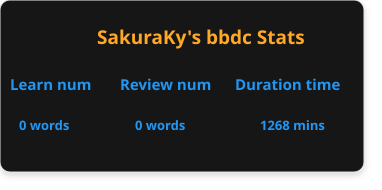

<div align="center">
  
  
</div>

如果觉得这个项目不错，那就给个star吧 💕

# 使用方式

原来的公共地址 `stat.leftover.cn` 已经停止部署。现在推荐使用 GitHub Actions 定时生成静态 SVG，不需要 Vercel 或其他第三方图床。

1. 将本项目推送到你账号下的公开 GitHub 仓库。
2. 仓库中的 `.github/workflows/update-card.yml` 默认每天更新一次卡片，也可以在 Actions 页面手动运行。
3. 将工作流里的 `BBDC_USER_ID` 和 `BBDC_NICKNAME` 改成自己的参数。
4. 在 GitHub 个人主页 README 中引用仓库里的 `bbdc-card.svg`。

例如，仓库为 `https://github.com/SakuraKy/github-bbdc-stat` 时，可以使用：

```markdown
[](https://github.com/SakuraKy/github-bbdc-stat)
```

`userId` 是你的不背单词 ID：进入不背单词 App 首页，点击左上角头像，再点击右上角设置，滚动到底部即可查看。

首次使用时也可以手动生成：

```bash
npm ci
BBDC_USER_ID=YOUR_ID BBDC_NICKNAME=SakuraKy npm run generate:card
```

生成的 `bbdc-card.svg` 会提交到仓库，GitHub README 可以直接引用公开仓库里的 SVG 文件。

如果需要动态 HTTP 接口，本项目仍然保留 Express 服务，可自行运行或部署：

```bash
npm start
```

请求地址为 `http://localhost:8000/bbdc?userId=YOUR_ID&nickname=SakuraKy`。

# 可配置参数

- `userId`：不背单词 ID（必填）
- `nickname`：卡片显示的昵称，默认 `leftover`
- `theme`：`dark` 或 `light`，默认 `dark`
- `hide_border`：`true` 或 `false`，默认 `false`
- `text_color`：十六进制色码（可省略 `#`）或颜色单词，如 `yellow`
- `title_color`：十六进制色码（可省略 `#`）或颜色单词，如 `yellow`

# 故障排查

- 图片显示破图图标和替代文本时，先在浏览器直接打开图片 URL。
- 如果看到 `DEPLOYMENT_DISABLED` 或 `Payment required`，说明使用的旧 Vercel 地址已停用，请改用 GitHub Actions 静态卡片。
- 如果 GitHub 上仍然显示旧卡片，进入仓库 Actions 手动运行 `Update BBdc card`，并等待新的提交。
- `/bbdc` 在参数错误或上游故障时也会返回可见的 SVG 错误卡片，并带有 `X-BBDC-Error` 响应头，便于定位问题。
- GitHub 可能缓存旧图片；更换域名或参数后会生成新的图片地址，必要时强制刷新页面。

# todo

1. 多集成一些主题
2. 自定义card的大小

# 求助
现在的卡片昵称需要手动指定，有没有办法获取不背单词 App 中的用户昵称？（非常感谢）

# Contribute

如果您有什么建议、或者发现了bug，请提一个[issue](https://github.com/left0ver/github-bbdc-stat/issues)，也欢迎大家提[PR](https://github.com/left0ver/github-bbdc-stat/pulls)，一起把这个项目做好

# LICENSE

github-bbdc-stat is used LICENSE  as [GPL-3.0](https://github.com/left0ver/github-bbdc-stat/blob/main/LICENSE)


